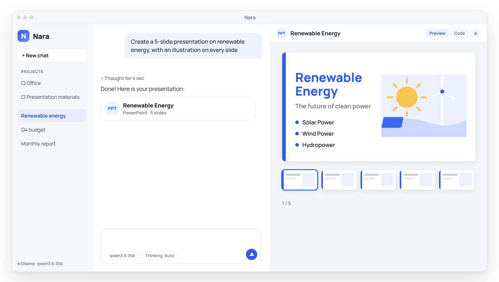
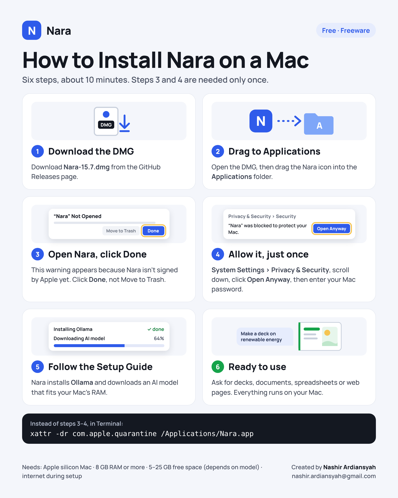

<p align="center">
  
</p>

<h1 align="center">Nara</h1>

<p align="center">
  <b>Your own local AI.</b> An AI on your Mac that doesn't just answer, it makes things.
</p>

<p align="center">
  <a href="../../releases/latest"><b>⬇ Download Nara for Mac</b></a> ·
  <a href="[VIDEO LINK]">▶ Watch the 1-minute video</a>
</p>

<p align="center">
  
</p>

---

## What is Nara?

Nara is a Mac app for chatting with **AI that runs on your own computer**, with an **artifact panel**: what the AI makes appears right next to the chat, ready to use and download.

Nara is the interface. The brains are **[Ollama](https://ollama.com)** and **open AI models** (such as Gemma and Qwen), running entirely on your Mac.

| | |
|---|---|
| **Free** | No subscription, no usage limits. Nara is freeware. |
| **Private** | Your chats, documents and attachments never leave your device. Once set up, Nara works offline. |
| **Ready to use** | Real, finished work, not just answers you have to copy, paste and assemble yourself. |

## What it can make

- **PowerPoint** decks with an illustration on every slide
- **Word** documents for reports, guides and letters
- **Excel** sheets with formulas that actually calculate
- **Web pages**, calculators and **diagrams** you can try right away
- **Revisions in plain words**, for example "change the theme color to green". Nara edits only what needs to change, and earlier versions are kept.
- **Export** to PowerPoint, Word, PDF, Excel, Markdown or HTML

Also included: projects with instructions and knowledge files, PDF/Word/Excel/image attachments as input, adjustable reasoning, chat history and search, and an interface in English and Bahasa Indonesia.

## Requirements

- A Mac with **Apple silicon** (M1 or later) <!-- TODO: remove if the DMG also runs on Intel Macs -->
- **8 GB of RAM** or more (16 GB or more is more comfortable)
- **5–25 GB** of free space, depending on the model you choose
- An internet connection during setup (to download Ollama and a model)

## Install

<p align="center"></p>

1. **Download** `Nara-<version>.dmg` from [Releases](../../releases/latest).
2. **Open** the DMG and **drag Nara** into the **Applications** folder.
3. **Open Nara.** Because Nara isn't signed by Apple yet, macOS shows *“Nara” Not Opened*. Click **Done** (not *Move to Trash*).
4. Open **System Settings → Privacy & Security**, scroll down to **Security**, click **Open Anyway**, and enter your Mac password. You only need to do this once.
5. Follow the **Setup Guide**: Nara checks your Mac, installs Ollama, then recommends and downloads a model that fits your RAM.
6. Done. Try: *"Create a 5-slide presentation on renewable energy, with an illustration on every slide."*

<details>
<summary>Alternative to steps 3–4 (Terminal)</summary>

```bash
xattr -dr com.apple.quarantine /Applications/Nara.app
```
After that, Nara opens like any other app.
</details>

### Models recommended by the Setup Guide

| Mac RAM | Model | Download size |
|---|---|---|
| 8 GB | `gemma4:e2b-it-qat` | 4.3 GB |
| 12 GB | `gemma4:e4b-it-qat` | – |
| 16–24 GB | `gemma4:12b-it-qat` | 7.2 GB |
| 32–36 GB | `gemma4:26b-a4b-it-qat` | 16 GB |
| 40 GB or more | `qwen3.6:35b` | 23 GB |

You can download or remove other models at any time in **Settings → Manage Ollama models**. Nara can also use **LM Studio** as its AI engine.

## Updating and uninstalling

- **Update:** download the new DMG, drag Nara into Applications and choose *Replace*. Your chats, projects and settings are kept.
- **Your data** lives in `~/Library/Application Support/Nara` (menu **Tools → Open data folder**).
- **Uninstall:** move Nara from Applications to the Trash, and delete the data folder above if you wish. AI models are managed by Ollama and can be removed with `ollama rm <model-name>`.

## Report a problem or share feedback

Click the **flag** icon at the bottom left of Nara, or use **Help → Report a problem…**. Nara prepares a report with the error code and technical notes (your chat is only included if you tick the box) and opens an email to the author. You can also open an [issue](../../issues) in this repository.

## License

Nara is **freeware**: free to use and to share in its original, unmodified form. It may not be sold, modified or reverse engineered. See [LICENSE.txt](LICENSE.txt). The open-source components Nara uses, and their licenses, are listed in **About Nara → Third party**.

Nara is not affiliated with Apple, Ollama, Google or Alibaba. AI models are subject to their own licenses.

## Author

**Nashir Ardiansyah** · nashir.ardiansyah@gmail.com
